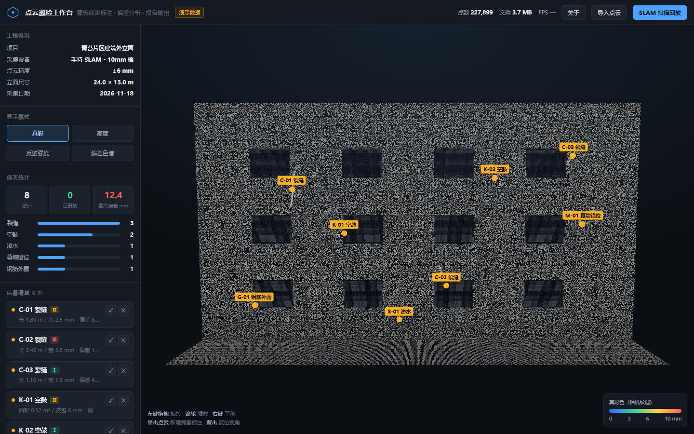

# PointCloud Inspector · 点云巡检工作台

浏览器里的三维点云标注与偏差分析工具：加载扫描点云 → 浏览与切片 → 查看偏差色谱 → 标注病害 → 出巡检报告。

单文件前端，22.7 万点实时渲染 60 FPS，支持导入自有 `.ply` / `.xyz` / `.csv`。



## 功能

| 模块 | 说明 |
|---|---|
| **扫描回放** | 点云按 SLAM 行进顺序逐段出现，相机跟随扫描路线，还原「边走边扫、边扫边建」的过程 |
| **四种着色** | 真彩 / 高度 / 反射强度 / 偏差色谱（相对设计平面，0–10 mm 分档） |
| **点云拾取** | 单击任意位置落一个标注点，填类型、等级、尺寸，场景内即时显示标记 |
| **预标注复核** | 支持「AI 预标注 → 人工确认 / 标误报」的工作流，统计复核进度 |
| **报告输出** | 一键生成 Markdown 巡检报告（工程概况、分级统计、病害清单、处理建议），或导出 CSV 清单 |
| **数据导入** | 拖入 `.ply`（ASCII）/ `.xyz` / `.csv`，自动居中缩放后直接浏览标注 |

## 技术实现

### 点云数据格式

自定义二进制，比 JSON 小一个数量级：

```
[Float32 xyz × N] [Uint8 rgb × N] [Uint8 强度 × N] [Uint8 扫描序号 × N]
```

22.7 万点 = 3.7 MB。等价的 JSON 要 20 MB 以上，浏览器解析还会卡。

### 渲染

- three.js `Points` + `BufferGeometry`，顶点色，`sizeAttenuation` 按距离缩放点大小
- 设备像素比封顶 2，避免高分屏上无谓的 4 倍填充率
- 着色模式切换时直接改写 color attribute 的 `Float32Array`，不重建几何体

### 「边走边建」动画

每个点带一个「扫描序号」（按 SLAM 行进方向分段，0–47）。加载时按序号重排整份点云，动画时用 `geometry.setDrawRange(0, n)` 逐段放出——不需要排序每帧，也不额外占显存。

### 交互

- 轨道控制是自己写的（旋转 / 缩放 / 平移 / 触摸双指），没有用 `OrbitControls`
- 拾取用 `Raycaster` + `raycaster.params.Points.threshold`，命中点即标注位置
- 标注标签是 HTML 元素，每帧把三维坐标 `project()` 到屏幕坐标后定位，比 Sprite 文字更清晰

## 本地运行

```bash
python -m http.server 8000
# 打开 http://localhost:8000
```

（`fetch` 读 `data.bin` 需要 HTTP 服务，直接双击 HTML 会被 CORS 拦）

## 数据说明

`data.bin` 由 `gen_pc.py` **程序化生成**，不是真实项目数据：

- 24 × 13 m 建筑立面，4 cm 点距，±1.5 mm 噪声
- 4 × 3 窗洞（含玻璃面与窗框）、地面扫描带
- 3 条裂缝（凹槽 + 两侧剥落）、2 处空鼓（鼓包 6 mm）、1 处渗水（色差）、1 处幕墙错台（8 mm）、1 处钢筋外露

缺陷同时写在 `meta.json` 里作为「AI 预标注」的种子数据，可用来验证标注 → 统计 → 报告的完整链路。

改布局重新生成：

```bash
python gen_pc.py
```

## 已知限制

- 没有做八叉树 LOD，单次全量加载。真实项目上亿点必须走 PotreeConverter 切片 + 分块流式加载
- 偏差是「相对设计平面」的法向距离，真实项目要先做点云与 BIM 配准（ICP）
- 标注只存在内存里，刷新即丢，没有接后端
- 移动端只做了手势适配，标注表单在窄屏上体验一般

## 下一步

1. 八叉树 LOD + 分块加载，支撑上亿点
2. 点云与 BIM 模型配准（ICP）+ 构件级偏差色谱
3. 标注结果落库，支持多人协作与质检流转
4. 缺陷区域自动聚类，减少人工标注量

## 目录

```
index.html      界面与样式
app.js          渲染、轨道控制、拾取、标注、统计、报告（约 750 行）
gen_pc.py       演示点云生成脚本
data.bin        点云二进制（227k 点，3.7 MB）
meta.json       点数、包围盒、扫描段数、缺陷真值
three.min.js    three.js r128 本地副本
```
